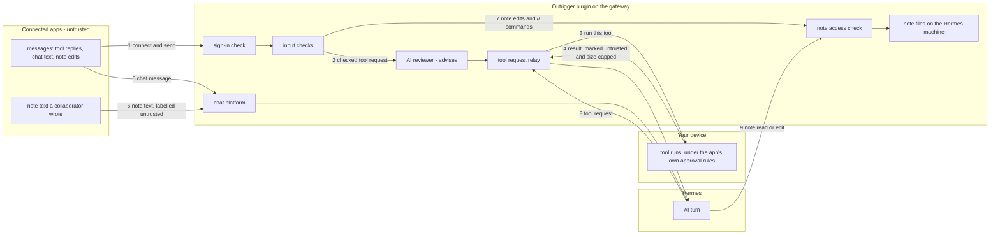
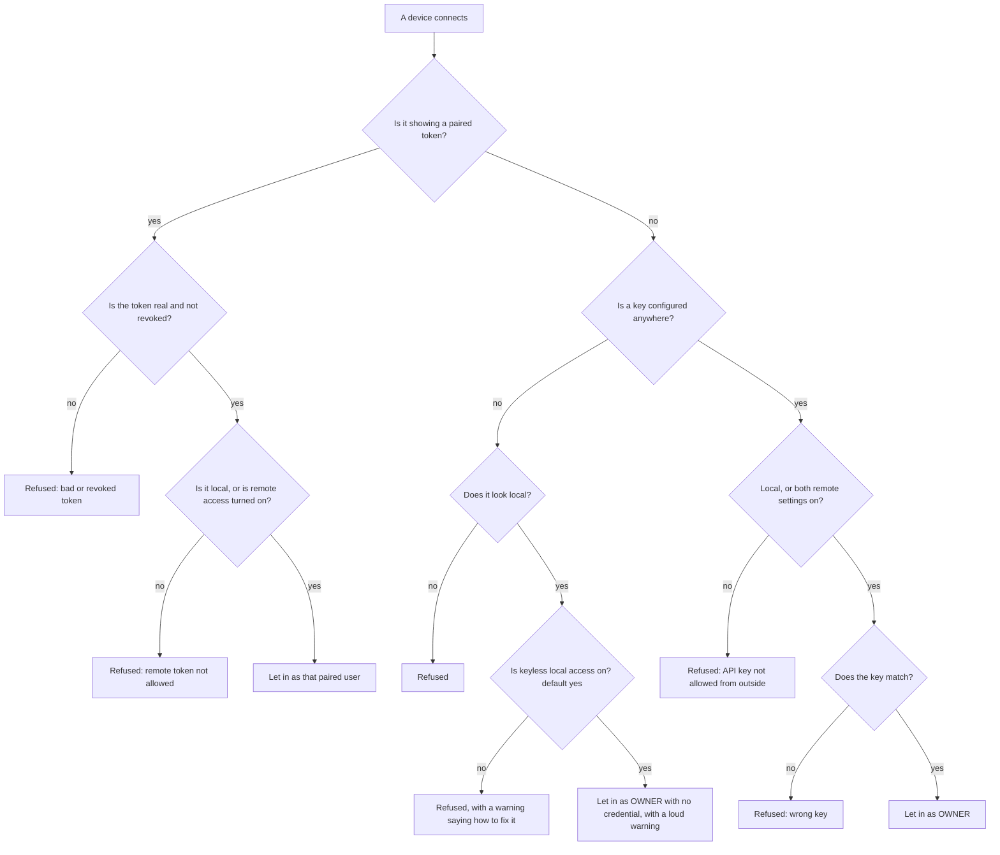
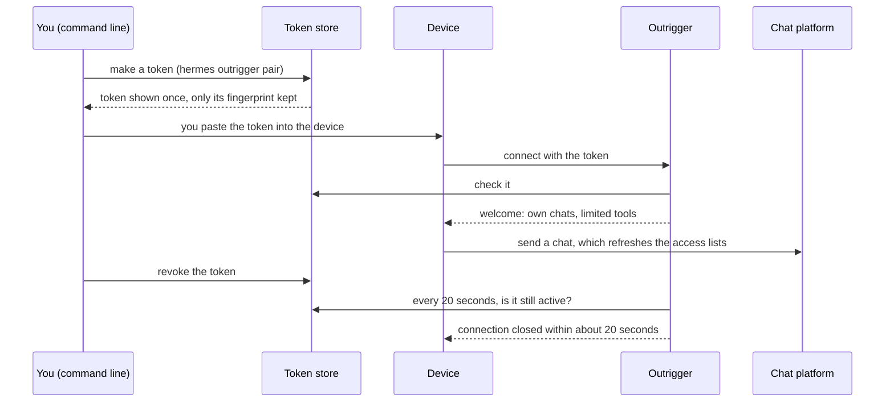
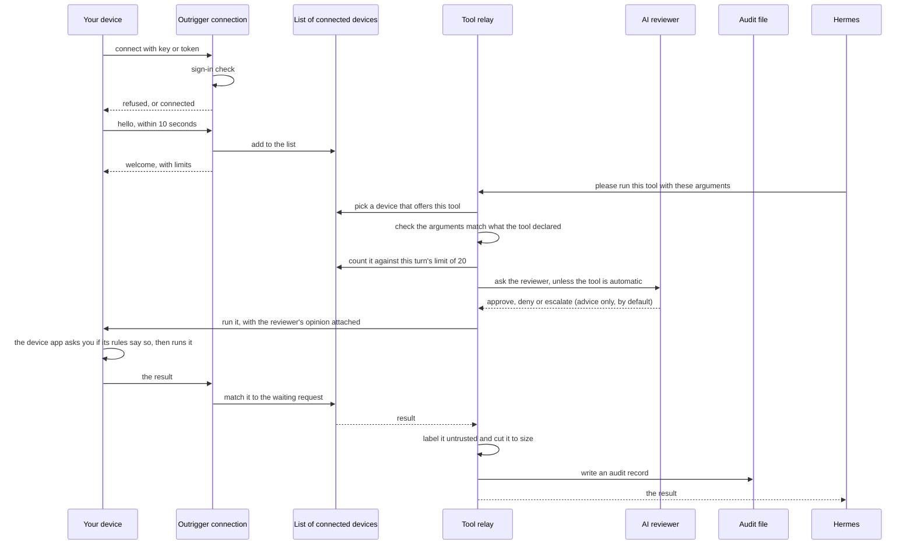
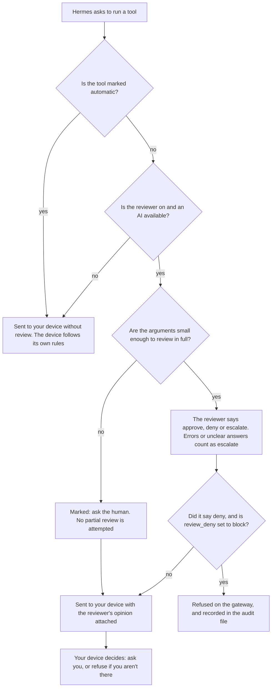
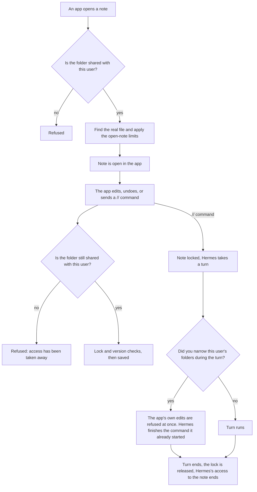

# Outrigger: security audit guide

This guide explains, in plain language, how the Outrigger plugin lets other devices
connect to your Hermes gateway: what can go wrong, what stands in the way, and what
risk is left over. It is written to be read top to bottom by a person.

How to read it:

- Each topic follows the same pattern: **what happens**, **what could go wrong**,
  **what protects you**, and **what's left** (the residual risk).
- Diagrams come with a short "how to read this diagram" note.
- Lines starting with **Code:** point at the exact source lines (`file:line`) for an
  auditor who wants to check a claim. Skip them if you are reading for understanding.
  CI checks that every one still points at real code.
- Words in *italics* are explained in the [glossary](#glossary).

Deeper background: `docs/security-review/auth-trust-boundary.md` (the threat model for
the sign-in limits described below) and `docs/security-review/remediation.md` (the
ledger of every finding, F-01 to F-11, and how each was handled). Those are historical
records; this guide is the living explanation.

## The system in one minute

Outrigger is a plugin for your Hermes gateway. It lets a small app on another device
(the sidebar in your browser, a phone, an Office add-in) connect to Hermes and offer
*client tools*: things Hermes can ask that device to do, which then run **on that
device**, not on the gateway. It also adds two features:

- **Notebook mode:** open `.md` notes that live on the Hermes machine, edit them
  together, and ask Hermes to work on one by typing a `//` command in the note.
- **The Outrigger chat platform:** chats from these apps go through Hermes's normal
  chat pipeline, like a message from Discord would.

It adds one web address to the gateway, `/v1/outrigger/ws` (a *WebSocket*). The
gateway's own sign-in checks don't cover plugin addresses, so Outrigger checks every
connection itself.

The parties, and how much each is trusted:

1. **You, the owner.** Full control. Your chats can use everything Hermes can,
   including terminal and file tools on the Hermes machine.
2. **Paired users.** People (or your own devices) you gave a *paired token*. They get
   only what you granted: their own chats, a limited set of tools, and only the note
   folders you shared.
3. **Connected apps and the text they send.** Untrusted. Tool arguments, chat text and
   note text all arrive from outside, and a note a collaborator wrote can contain text
   aimed at tricking the AI (*prompt injection*).
4. **Hermes, the AI.** Trusted to do useful work, but it can be fooled by what it
   reads, so its requests to devices are checked.

The security work comes down to three questions: **who is connecting?**, **what are
they allowed to touch?**, and **should this request run?**

## The main risks at a glance

| # | Risk | Example | Main protection | What's left |
|---|------|---------|-----------------|-------------|
| 1 | A stranger connects as you | Something on the network reaches the gateway and is treated as the owner | Every connection must show the API key or a paired token, and remote access is off by default ([sign-in](#who-is-connecting-sign-in)) | **With no key configured at all, a local connection is let in as owner with no credential (on by default)**, and a relay on the same machine can look local |
| 2 | Hermes makes a device do something harmful | A note tells Hermes to run a damaging tool on your laptop | The device's own approval rules, plus an AI reviewer's opinion ([tool requests](#how-a-tool-request-flows)) | The reviewer only advises by default; the device app is what actually asks you |
| 3 | A paired user reaches beyond what you shared | A user edits a note outside their folder, or reads another person's chat | Folder grants checked on every edit; chats separated per token ([notebook](#notebook-who-may-edit-which-note), [chat separation](#chat-separation-and-admin-tools)) | Tools already running when you narrow a grant finish their command |
| 4 | A paired user gets your powerful tools | A user's chat gets terminal access | Paired users get a narrow tool set unless marked admin ([admin tools](#chat-separation-and-admin-tools)) | The gateway knows users, not tokens, so mixed admin/non-admin tokens for one user behave conservatively, with edge cases |
| 5 | A leaked token keeps working | You revoke a lost phone's token | Revoked tokens are refused at once for new connections ([tokens](#paired-tokens)) | An already-open connection lasts up to about 20 seconds more |
| 6 | Malformed input breaks something | An oversized schema or a crafted tool name | Strict checks on every message and tool description ([input checks](#input-checks)) | Relies on the `jsonschema` library being installed (refuses tool schemas without it) |
| 7 | A record of what happened goes missing | The audit file can't be written | Failures are logged loudly and counted ([audit trail](#audit-trail)) | No tamper-evidence; notes and chats aren't in the audit file |

The full list, ranked, is in [Residual risks](#residual-risks).

## Defaults you should know

Settings live under the plugin's config in Hermes. Out of the box:

| Setting | Default | What it means for you |
|---------|---------|-----------------------|
| `allow_remote` | **off** | Only connections from the Hermes machine itself are accepted. Turn on to let other devices in with a paired token |
| `owner_key_remote` | **off** | Even with remote access on, the API key only works locally; remote devices need a paired token |
| `allow_keyless_local` | **on** | If no key is configured anywhere, a local connection is accepted as **owner with no credential**. Configure a key, or turn this off |
| `review` | **smart** (on) | An AI reviewer gives an opinion on each tool request that isn't automatic |
| `review_deny` | **ask** | When the reviewer says "deny", the request still goes to your device, marked as flagged, for you to decide. `block` makes a deny final |
| `allow_subagents` | **off** | Helper agents Hermes starts can't use your devices or notes |
| `notebook_roots_for` | **empty** | Paired users can open no notes until you share a folder with them |
| `user_toolsets` | web, outrigger, no MCP | What paired non-admin users' chats can use: no terminal or file tools |
| `max_calls_per_turn` | 20 | A single Hermes turn can make at most 20 device tool calls |
| `audit_args` | **off** | The audit file records that a tool ran, not its arguments |

Settings written as text (`"false"`) are read correctly as on/off; an unreadable value
falls back to the default above, with a warning.

Code: outrigger/settings.py:43-85 (defaults), outrigger/settings.py:23-41 (reading
on/off values), outrigger/settings.py:90-99 (loading)

## Who talks to whom

**What this diagram shows:** the four zones and the paths data takes between them.
Boxes are parts of the system; arrows are data moving. The danger points are where an
arrow leaves the untrusted zone on the left, and where something reaches the right
side, where real effects happen: a device runs a tool, a note file changes, or Hermes
takes a turn.

How to read it, arrow by arrow:

1. **App → sign-in.** Every connection is checked before anything else
   ([sign-in](#who-is-connecting-sign-in)).
2. **Input checks → reviewer.** Messages and tool arguments are checked for shape and
   size first ([input checks](#input-checks)).
3. **Relay → your device.** The tool runs on the device. Outrigger passes requests
   on; it doesn't contain or sandbox what the device does. The device app's own rules
   decide whether to ask you.
4. **Result → Hermes.** What comes back is labelled untrusted and cut to a maximum
   size before the AI sees it.
5. **Chat → Hermes.** Chats join Hermes's normal pipeline, with tool limits for
   paired users ([admin tools](#chat-separation-and-admin-tools)).
6. **Note text → Hermes.** When you type a `//` command, the note's text goes to
   Hermes labelled as untrusted. **This is a label, not a wall:** Hermes still reads
   whatever a collaborator wrote.
7. **Note edits.** Every edit from an app is checked against the folders that user
   was granted ([notebook](#notebook-who-may-edit-which-note)).
8. **Hermes → relay.** Hermes asking a device to run a tool (arrow 3 continues it).
9. **Hermes → notes.** Hermes can read or edit only the note whose `//` command it is
   currently working on.

Code: outrigger/__init__.py:19 (the one address), outrigger/__init__.py:122-131
(where it is added), docs/spec.md:40-41 (the plugin passes requests on, it doesn't
sandbox)

## Who is connecting (sign-in)

*How Outrigger decides who you are when a device connects.*

**What happens:** a connecting app shows one of two credentials:

- **The API key:** the gateway's master key. Whoever holds it is the owner.
- **A paired token** (`otr_…`), made with `hermes outrigger pair`. It belongs to one
  user, gives only what you granted, and can be revoked.

Then Outrigger checks *where* the connection comes from. "Local" means it came from
the Hermes machine itself and carries none of the headers a reverse proxy or tunnel
adds. Remote connections need `allow_remote`; the API key from a remote device also
needs `owner_key_remote`. Both are off by default.

**How to read this diagram:** start at the top with an incoming connection and follow
the questions down to a box. Boxes starting "Refused" turn the connection away. The
two "Let in as OWNER" boxes are where someone gets full control: the one ending "with
no credential" is the risky one, because nobody showed a key.

**Where the key comes from:** Outrigger looks for the key in this order: the plugin's
own `auth_token` setting, then the key the gateway itself uses, then the
`API_SERVER_KEY` environment variable. So a gateway with a key in its config isn't
mistaken for a gateway with no key.

**What could go wrong:**

- **"Looks local" is a guess, not proof.** If something on the Hermes machine relays
  network traffic without adding proxy headers (an `ssh -L` tunnel, `socat`, a bare
  web server proxy), outside connections arrive looking local. With no key configured
  and keyless access on (the default), such a connection is let in as owner. Each
  time this happens, the log says so loudly. There is no reliable way to tell these
  apart over a normal network connection; the real fix (a local-only socket that
  identifies the process) is outside this plugin's current design.
- **Gateways that don't share their key.** On gateway versions that don't expose
  their key to plugins, Outrigger only sees its own setting and the environment
  variable, so it may believe no key exists. Both currently installed gateway variants
  do share it.

**What protects you:** configure a key (any of the three places), or set
`allow_keyless_local` to off. Either removes the no-credential owner path entirely.
Credentials are compared in constant time, so timing doesn't leak how much of a key
was right. A browser web page can't use your gateway because the gateway itself
rejects unknown browser origins; Outrigger doesn't add its own check here, so **never
set `cors_origins: '*'` on a gateway without a key**.

**What's left:** see risk 1 in [Residual risks](#residual-risks).

Code: outrigger/auth.py:105-166 (the whole check), outrigger/auth.py:34-49 (where the
key comes from), outrigger/auth.py:79-87 (what "looks local" means),
outrigger/auth.py:149-155 (owner with no credential, and its warning),
outrigger/auth.py:145-148 (refused when keyless access is off), outrigger/tokens.py:135-155
(token check)

## Paired tokens

*How you hand out and take back limited access.*

**What happens:** `hermes outrigger pair --user <name>` makes a token and shows it
once. Only a scrambled fingerprint (a SHA-256 *hash*) is stored, in a file only your
account can read. You paste the token into the device. Revoking marks it revoked; the
store is re-read automatically when the file changes, so no restart is needed.

**How to read this diagram:** time runs top to bottom. It follows one token from
creation, through use, to revocation. The last two lines show the delay: an open
connection is only checked every 20 seconds.

**What could go wrong:** a lost device keeps its connection briefly after you revoke.
**What protects you:** new connections with a revoked token are refused immediately,
and an open one closes at the next 20-second check. This delay is a deliberate design
choice. Checking an unknown token takes the same time as checking a known one.

**What's left:** up to about 20 seconds of continued access after revoking. Also, if
the token file is damaged into the wrong shape (for example, valid JSON that isn't a
list of tokens), loading it raises an error rather than treating the store as empty:
nobody gets in, and the log shows the error (finding H-02; a fix is open in PR #4).

Code: outrigger/tokens.py:86-111 (make), outrigger/tokens.py:114-126 (revoke),
outrigger/tokens.py:68-79 (saved readable only by you), outrigger/tokens.py:44-65
(loading, finding H-02), outrigger/tokens.py:158-164 (still active?),
outrigger/ws.py:107-116 (the 20-second check), outrigger/ws.py:36 (the interval),
outrigger/cli.py:28-63 (the pair command)

## How a tool request flows

*What happens, start to finish, when Hermes asks a device to do something.*

**What happens:** Hermes calls `outrigger_call` with a tool name and arguments. The
request is checked, optionally reviewed, sent to the device, and the answer comes back.

**How to read this diagram:** time runs top to bottom; each arrow is one message. The
first half is the device connecting; the second half is one tool request.

Limits along the way: each device runs one request at a time unless it asks for more (up to 8), each request has a
time limit (at most 400 seconds), each Hermes turn can make at most 20 device calls,
and results are cut to 20,000 characters. Error messages from the device are cleaned
and shortened too.

**What could go wrong:** a note or web page tricks Hermes into asking for a harmful
action. **What protects you:** the device app's own rules (the next section) and the
reviewer's opinion. **What's left:** Outrigger itself doesn't ask you; the device
app does. If a device app ignores its own rules, Outrigger won't stop it.

Code: outrigger/dispatch.py:96-230 (the relay), outrigger/dispatch.py:125-127 (pick a
device), outrigger/dispatch.py:133-136 (argument check), outrigger/dispatch.py:138-141
(per-turn limit), outrigger/dispatch.py:193-200 (sent to the device),
outrigger/dispatch.py:233-246 (labelled untrusted, cut to size), outrigger/ws.py:440-458
(results arriving), outrigger/ws.py:209-248 (adding a device)

## Approving tool requests

*Who decides whether a requested tool actually runs.*

**What happens:** each tool a device offers declares a policy:

- **auto:** runs without asking (for harmless things).
- **confirm:** the device should ask you first. This is the default.
- **deny_when_unattended:** refuse unless you're actively using the device.

These policies are **carried out by the device app**. For Hermes, they are only
information. Outrigger adds an AI *reviewer*: for any tool that isn't automatic, it
asks an AI to judge the request and attaches the opinion (approve, deny, or escalate
meaning "ask the human") to the request.

**How to read this diagram:** start at the top with a request and follow the
questions down. Almost every path ends at "sent to your device, with advice". Only
one path refuses the request on the gateway: a deny with `review_deny` set to `block`.

**What could go wrong:** the reviewer approves something harmful, or the device app
ignores a "deny" opinion. **What protects you:** with the default `review_deny =
ask`, a deny reaches your device as a flagged request for you to decide; set it to
`block` to make denials final on the gateway. Arguments too large to review in full
(over 8,000 characters) are never judged on a partial view; they're marked "ask the
human".

**What's left:** by default the reviewer only advises. Your protection against a
harmful request is the device app showing you a prompt.

Code: outrigger/reviewer.py:111-184 (the reviewer), outrigger/reviewer.py:40-47 (size
limit and cleaning), outrigger/reviewer.py:132-142 (too large means ask the human),
outrigger/reviewer.py:179-183 (errors mean ask the human), outrigger/dispatch.py:144-161
(where the opinion is used, and the block option), outrigger/dispatch.py:198-199 (the
opinion travels with the request), outrigger/settings.py:69-72 (review settings),
outrigger/context.py:19-27 (policies are information for Hermes)

## Input checks

*How Outrigger handles malformed or hostile messages.*

**What happens:** everything a device sends is checked before use.

- **Tool descriptions:** names must match a strict pattern; at most 64 tools per
  device; the description of each tool's arguments (its *schema*) must be under 32 KB,
  not too deeply nested, and may not point at outside web addresses. Outrigger never
  fetches anything a schema points to.
- **Tool arguments** from Hermes are checked against the tool's schema before being
  sent. Text-pattern rules in schemas are ignored on the gateway, because a crafted
  pattern can make checking take forever.
- **Names and chat ids** reject sneaky trailing line breaks (finding F-11).
- **If the `jsonschema` library is missing,** tool schemas are refused outright
  (with an error in the log) and arguments get a simpler built-in check.

**What's left:** the checks rely on the `jsonschema` library for full validation.

Code: outrigger/protocol.py:27 (name pattern), outrigger/protocol.py:47-97 (tool
descriptions), outrigger/protocol.py:140-178 (schema limits), outrigger/protocol.py:122-137
(no outside addresses), outrigger/protocol.py:185-201 (never fetched),
outrigger/protocol.py:204-215 (pattern rules ignored), outrigger/protocol.py:218-241
(argument check), outrigger/protocol.py:255-301 (the simpler built-in check),
outrigger/protocol.py:170-173 (refused without the library), outrigger/ws.py:185-202
(reading messages), outrigger/ws.py:259 (chat id pattern), outrigger/tokens.py:33-34
(token and user patterns)

## Notebook: who may edit which note

*How note folders are shared, and how that sharing is checked.*

**What happens:** you list note folders in the settings. You (the owner) can open any
of them. A paired user can open only the folders you list for them in
`notebook_roots_for` (none by default). Only `.md` files can be opened; paths that
climb out of a folder (`..`), hidden files and links pointing outside are refused.

The folder check runs **on every edit**, not just when the note is opened. If you
take a folder away from someone, their next edit is refused, even with the note still
open on their screen. There are also limits: 64 open notes in total, 16 per device.

When someone types a `//` command, the note is locked, Hermes takes a turn, and during
that turn Hermes may read and edit **only that note**.

**How to read this diagram:** the top half is an app opening and editing a note. The
bottom branch is a `//` command, including what happens if you narrow someone's access
while Hermes is still working on their command.

**What could go wrong:** you remove someone's folder mid-command and expect Hermes to
stop working on it at once. **What protects you, and what doesn't:** the user's own
edits stop immediately. Hermes's work on a command that already started was
authorised when it started, and **continues until the turn ends**. This is a
deliberate decision (owner, 19 Nov 2026), pinned by a test so it can't change
silently.

**What's left:**

- The in-flight command finishes, as above.
- A user whose access was removed still receives change notifications for a note they
  still have open, until they close it.
- Two hard links to the same file are treated as two separate notes.
- Hermes reads a cached copy of the note; edits re-read the file first, so nothing is
  overwritten. A deleted note can be re-created from that cache if Hermes edits it.
- The note's text goes to Hermes labelled untrusted, but Hermes still reads it, so a
  collaborator can try to steer Hermes through what they write.

Code: outrigger/notebook.py:70-84 (shared folders), outrigger/notebook.py:101-120
(path checks), outrigger/notebook.py:304-321 (re-checked on every edit),
outrigger/notebook.py:231-279 (opening and limits), outrigger/notebook.py:221-228 (making room
by closing idle notes), outrigger/notebook.py:340-356 (lock and version checks on edits), outrigger/notebook_tools.py:21-41
(Hermes may touch only the note being worked on), outrigger/notebook_tools.py:72-137
(Hermes's read and edit), outrigger/notebook.py:454-514 (// commands),
outrigger/notebook.py:489-499 (note text labelled untrusted), outrigger/notebook_tools.py:87
(read results labelled untrusted), outrigger/notebook.py:410-433 (change
notifications), outrigger/notebook.py:324-337 (deleted-note handling),
outrigger/ws.py:311-403 (note messages)

## Chat separation and admin tools

*How paired users' chats are kept apart from yours and from each other, and which
tools their chats get.*

**What happens:**

- **Separate chats.** Each paired token's chats are named with the token's id, so one
  user can't open another's. The shared "home" chat (where scheduled results arrive)
  is yours only. Stopping a chat or answering a prompt requires owning that chat.
- **Limited tools.** Your chats get every Hermes tool. A paired user's chats get only
  `user_toolsets` (web and Outrigger tools, no terminal or files), unless their token
  is marked admin. Slash commands are limited to a short list you can change (`user_allowed_commands`).
- **Rate limits.** Paired non-admin users can send 20 chat messages or commands per
  minute.
- **Session binding** (attaching to an existing Hermes session) is owner only.

**What could go wrong:** a user has two tokens, one admin and one not. The gateway
identifies chats by *user*, never by *token*, so it can't tell which token a chat came
from.

**What protects you:** if any non-admin connection of that user is live, all their
chats are narrowed (the conservative choice). If the list of connections can't be read
reliably at that moment, tools are narrowed too.

**What's left:** with no live connection (a scheduled job, for example), the user's
admin status decides. The very first `//` command in a brand-new chat can run with the
user's admin status before narrowing catches up. Giving an existing admin user an
extra non-admin token is silent. Fixing these needs a change to Hermes's gateway.

Code: outrigger/platform.py:80-95 (chat naming and home), outrigger/platform.py:177-181
(chat ownership), outrigger/platform.py:321-326 (prompt answers), outrigger/ws.py:282-295
(chat actions), outrigger/platform.py:131-164 (which tools a user gets),
outrigger/platform.py:117-128 (admin list), outrigger/platform.py:152-158 (narrowed if
uncertain), outrigger/platform.py:407-438 (chats arriving, and the first-command
case), outrigger/auth.py:169-174 (who counts as a limited user),
outrigger/ws.py:48-66 (rate limit), outrigger/ws.py:428-435 (session binding
is owner only), outrigger/ws.py:236-237 (paired devices get no session)

## Helper agents

*Whether agents that Hermes starts in the background can use your devices.*

**What happens:** when Hermes starts a helper (a *subagent*), Outrigger marks that
helper's session. Marked sessions get no devices and no note tools while
`allow_subagents` is off (the default). Turning it on allows device calls, but helpers
still can't touch notes.

**What could go wrong:** very many helpers mark very many sessions. **What protects
you:** marks are never thrown away early, so a helper never quietly regains access.
Past 1,024 tracked helpers, each new mark logs a warning; that is a warning level,
not a limit. A mark that is never cleared costs memory, not access.

Code: outrigger/registry.py:147-185 (marking), outrigger/registry.py:215-239 (marked
sessions get no devices), outrigger/__init__.py:84-95 (where helpers are noticed),
outrigger/dispatch.py:49-50 and outrigger/dispatch.py:74-76 (relay refuses them),
outrigger/notebook_tools.py:36-37 (notes refuse them)

## Audit trail

*What gets recorded, and what doesn't.*

**What happens:** every tool request's outcome is written to `audit.jsonl`: which
tool, which user, and whether it succeeded, failed or was refused. Arguments are only
recorded if `audit_args` is on. Requests refused before a device was chosen are
recorded without a user.

**What could go wrong, and what protects you:** if the file can't be written (disk
full, permissions), the tool call still completes and the loss is logged as an error
with the details, and counted.

**What's left:**

- **Notes and chats aren't in the audit file.**
- **No tamper-evidence.** Someone who can edit the file can change history without
  trace, and the file grows without limit. The file is created readable only by you,
  but an older file keeps whatever permissions it had.
- **Finding H-01:** if saving a screenshot-style capture fails, the error skips that
  call's audit record. The call fails loudly in the log, but the outcome isn't in the
  audit file. A fix is open in PR #4.

Code: outrigger/audit.py:39-85 (writing records), outrigger/audit.py:76-85 (write
failures), outrigger/audit.py:29 (failure counter), outrigger/audit.py:95-134 (saving
captures, finding H-01), outrigger/dispatch.py:167-169 (where records are written)

## When things fail

*What Outrigger does when part of it breaks: refuse, warn, or carry on.*

| If this fails | It logs | It refuses | It carries on with |
|---------------|---------|------------|--------------------|
| Writing the audit file | An error with the details, and counts it | Nothing; that record is lost | The tool call |
| The note watcher crashes | An error, then restarts it | Nothing | Watching notes |
| The `jsonschema` library is missing | An error | All tool schemas | A simpler argument check |
| Arguments too large to review | A warning | A partial review | Asking the human |
| The reviewer errors | A warning | Nothing | Asking the human |
| Over 1,024 helper marks | A warning per mark | Nothing | Keeping every helper blocked |
| A setting can't be read | A warning naming it | That value | The default |
| A local connection with no key | A loud warning | Nothing (keyless local access is on by default) | Letting it in as owner |
| Same, with keyless local access off | A warning with the fix | That connection | Token and key sign-ins as normal |
| The connection list can't be read for admin tools | A warning | Full tools | Limited tools |
| A note's lock can't expire | A warning | That note stays locked | Other notes |
| Hermes's edit can't re-read the note | A refusal message | The edit (nothing is overwritten) | The note as it was |
| The note lock time setting is invalid | A warning | Nothing | 600 seconds |

Code: outrigger/notebook.py:599-624 and outrigger/notebook.py:571-596 (watcher
restart), outrigger/notebook.py:543-556 (lock expiry), outrigger/notebook_tools.py:121-124
(edit can't re-read), outrigger/notebook.py:532-540 (lock time setting)

## Security-sensitive units

*Where each security job lives in the code, for anyone reviewing or changing it.*
Every module listed carries a `# Audit: see AUDIT.md#security-sensitive-units`
comment pointing here. Changing one of these means updating this guide in the same
change (see AGENTS.md).

| Job | What it does | Where |
|-----|--------------|-------|
| Sign-in | Decides who is connecting | outrigger/auth.py:105-166; tokens: outrigger/tokens.py:135-164 |
| Access to notes, chats and tools | Decides what a user may touch | outrigger/notebook.py:70-84, outrigger/notebook.py:304-321, outrigger/notebook_tools.py:21-41, outrigger/platform.py:131-164, outrigger/platform.py:80-95, outrigger/registry.py:93-119 (device limits), outrigger/auth.py:169-174 (who counts as a limited user) |
| Input checks | Rejects malformed or hostile messages | outrigger/protocol.py:48-80, outrigger/protocol.py:140-178, outrigger/protocol.py:218-241, outrigger/protocol.py:307-342 (text field cleaning), outrigger/ws.py:185-202, outrigger/notebook_tools.py:91-107 (applying edits) |
| Audit | Records what happened | outrigger/audit.py:39-85, outrigger/dispatch.py:112-119 (refusals), outrigger/dispatch.py:155-158 |
| Review | Gives the AI reviewer's opinion | outrigger/reviewer.py:88-108 (setup), outrigger/reviewer.py:117-184 |
| Tokens | Makes, stores and revokes credentials | outrigger/tokens.py:37-41 (file location), outrigger/tokens.py:86-126, outrigger/tokens.py:167-173 (active users), outrigger/cli.py:14-25 |
| Helper agents | Keeps helpers away from devices and notes | outrigger/registry.py:147-185, outrigger/registry.py:208-209, outrigger/registry.py:227-229 |
| Settings | Reads the trust switches | outrigger/settings.py:23-41, outrigger/settings.py:102-105, outrigger/plugin.yaml:10-38 (settings descriptions) |
| Relay and result limits | Passes requests on and caps results | outrigger/dispatch.py:173-230, outrigger/dispatch.py:233-246, outrigger/ws.py:440-458 |
| Shared notes | Notifications, file watching, undo, locks | outrigger/notebook.py:410-433, outrigger/notebook.py:571-624, outrigger/notebook.py:366-390, outrigger/notebook.py:454-556 |

**Large modules that still hold more than one job** (each section marked with a
banner comment in the code):

- `outrigger/ws.py` holds the connection lifecycle (outrigger/ws.py:91-180), message
  routing (outrigger/ws.py:416-482, outrigger/ws.py:264-306), the rate limit
  (outrigger/ws.py:48-66) and incoming result limits. Its sign-in names are re-exported
  from `auth.py`.
- `outrigger/notebook.py` holds access checks, file storage, collaboration and
  locks. Hermes's note tools moved out to `notebook_tools.py`.
- `outrigger/dispatch.py` holds the relay, audit recording and device selection;
  capture saving moved to `audit.py`.
- `outrigger/platform.py` keeps the admin-tool decision next to the chat code,
  because that decision reads the live chat list directly; separating it wouldn't
  make it easier to review.
- `outrigger/registry.py` keeps the helper-agent gate next to the device list it
  depends on.

## Residual risks

Everything left over, ranked by how much it matters. Start here when deciding what to
fix next.

| Rank | Risk | Why it matters | Mitigation available now |
|------|------|----------------|--------------------------|
| 1 | **F-10: owner access with no credential when no key exists** (on by default), and "local" can be faked by a relay on the same machine | Full owner control, including terminal tools, for whoever reaches it | Configure a key, or set `allow_keyless_local` off. The full fix (a local socket) is outside this design |
| 2 | The AI reviewer only advises by default | A harmful request reaches the device; the device app's prompt is the real gate | Set `review_deny` to `block`; use device apps that confirm |
| 3 | Note text is labelled, not isolated | A collaborator can try to steer Hermes through what they write | Share folders only with people you trust |
| 4 | **F-10: admin status is per user, not per token** | Edge cases where a user's chat runs with admin tools | Don't mix admin and non-admin tokens for one user |
| 5 | "Remote" settings rely on the same locality guess | A relay may count as local | Use proxies that add proxy headers |
| 6 | Gateways that don't share their key | Outrigger may believe no key exists | Set the plugin's own `auth_token` |
| 7 | **F-05: a running `//` command outlives a narrowed grant** | Hermes finishes editing a note after you removed access | Decided behaviour; wait for the turn to end |
| 8 | **H-01: a failed capture save skips its audit record** | One outcome missing from the audit file | Fix open in PR #4 |
| 9 | Audit file not tamper-evident, unbounded, excludes notes and chats | History can be edited; the file grows | Back it up; watch its size |
| 10 | About 20 seconds of access after revoking a token | A lost device stays connected briefly | Deliberate; new connections are refused at once |
| 11 | Narrowed users still get change notices on open notes | They see edits until they close the note | Ask them to close it, or disconnect them |
| 12 | **H-02: a wrongly shaped token file raises an error** | Nobody can connect until it's fixed (no one gets in wrongly) | Fix open in PR #4 |
| 13 | Cached note reads; deleted notes can return | Confusing, not a leak | Re-open the note |

Details for the F-numbered items are in `docs/security-review/auth-trust-boundary.md`
and `docs/security-review/remediation.md`.

## Glossary

- **Gateway:** the Hermes server program that Outrigger plugs into.
- **Client / device app:** the sidebar, phone app or add-in that connects to
  Outrigger.
- **Client tool:** something Hermes can ask a connected device to do; it runs on the
  device.
- **Owner:** you, the person whose API key it is. Full control.
- **Paired token:** a limited, revocable credential (`otr_…`) for one user.
- **Admin token:** a paired token whose chats get the full tool set.
- **WebSocket:** a live, two-way connection between a device and the gateway.
- **Locality heuristic:** Outrigger's guess that a connection is "local": it came from
  the same machine and carries no proxy headers.
- **Relay / reverse proxy:** a program that forwards network traffic, so a remote
  connection appears to come from the local machine.
- **Prompt injection:** text written to trick an AI into doing something, hidden in a
  page or note.
- **Reviewer:** an AI that gives an opinion (approve, deny, escalate) on each tool
  request that isn't automatic.
- **Schema:** the description of what arguments a tool accepts.
- **Subagent (helper agent):** a background agent Hermes starts to work on part of a
  task.
- **Hash:** a scrambled fingerprint of a token; the token can be checked against it,
  but not recovered from it.
- **Audit trail:** the `audit.jsonl` file recording each tool request's outcome.

## How this guide stays accurate

- **CI checks it on every change** (`docs-audit`): every `file:line` reference must
  point at real code, every diagram must render, every security-related module must
  point back here, and wording that overstates protection is rejected.
- **Tests** pin the behaviour described here, including the decided F-05 in-flight
  behaviour (`tests/test_notebook_grants.py`) and that each module keeps its pointer
  (`tests/test_cohesion.py`).
- **Limits:** these checks confirm that references are still valid. Whether each
  sentence here is true is checked by reviewing the claims against the code.
