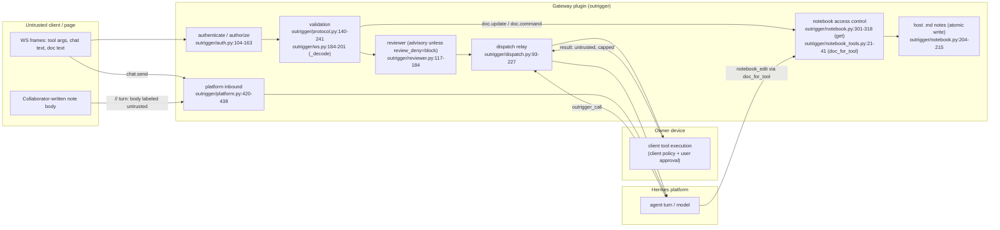
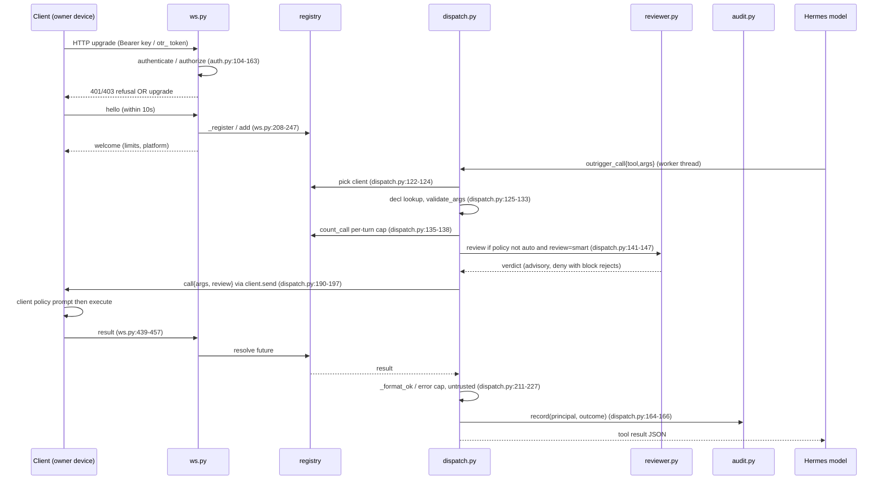
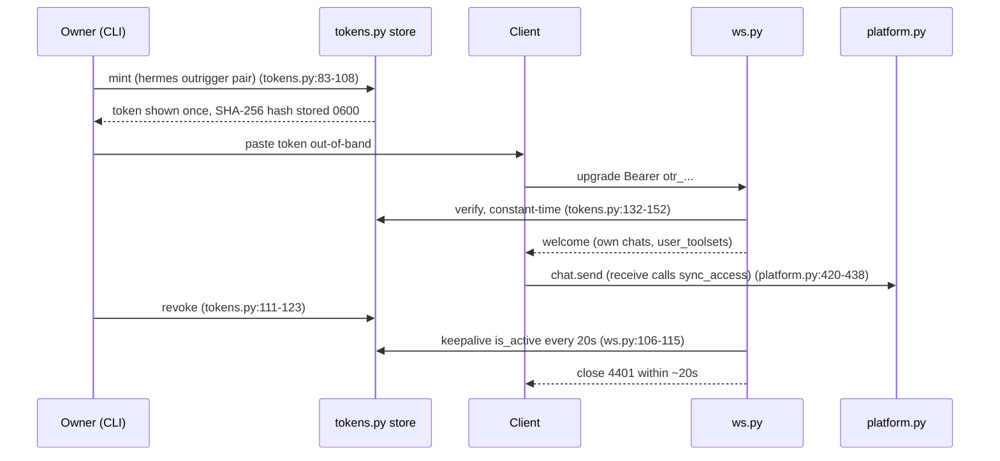
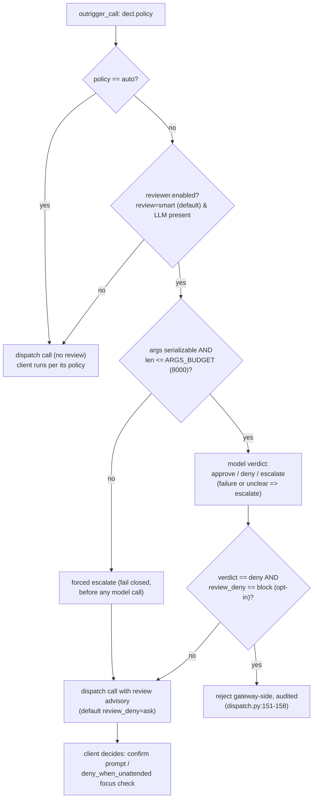
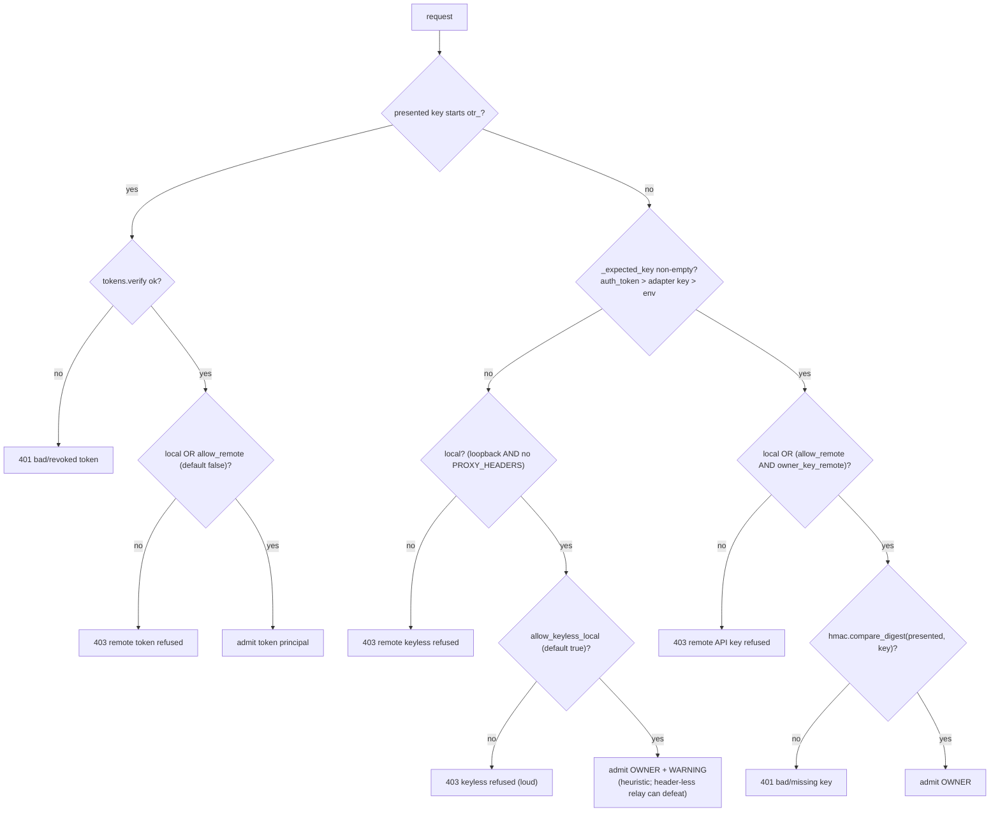
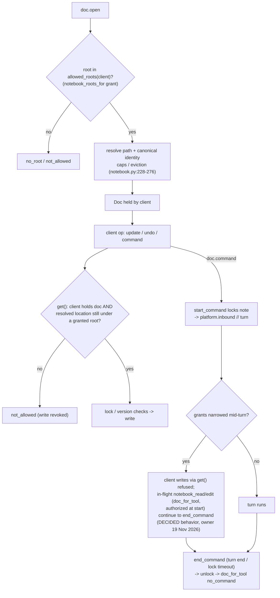

# Outrigger audit map

Outrigger is a Hermes gateway plugin (Python 3.14, manifest v2) that lets a thin
client — a browser side panel, a phone, an add-in — attach to the gateway over a
WebSocket and offer tools that run **on the client's own device**, plus a
notebook mode (edit `.md` notes on the host) and an "Outrigger" messaging
platform (client chats go through Hermes's own pipeline). It mounts one route,
`GET /v1/outrigger/ws`, on the `api_server` gateway app
(`outrigger/__init__.py:19`, wired at `outrigger/__init__.py:122-131`); plugin
routes get no gateway auth middleware, so the route authenticates itself
(`outrigger/auth.py:104-163`). The privileged sinks are: the client device executing
a tool call, the host note files, and the Hermes agent turn (which for the
owner/admin carries terminal/file tools).

**Read first:** this map, then `docs/security-review/auth-trust-boundary.md`
(the F-10 residual threat model — what the auth mitigations do and do not prove)
and `docs/security-review/remediation.md` (the F-01..F-11 ledger). The ledger
descriptions are claims from the remediation campaign; the anchors below were
re-verified against the current tree at branch `refactor/human-audit` (from main
at merge `27c07ba`), then re-resolved after the step-2 cohesion restructure
(behavior-preserving code moves: auth surface → `auth.py`, notebook tool surface
→ `notebook_tools.py`, capture writer → `audit.py`; no logic changed), and
again after the step-3 docstring pass (docstrings/comments only — line numbers
shifted, no logic changed). Where a
control only *mitigates* (F-10), this map says mitigates + residual, never
"fixed".

## Trust boundaries

Zones: the WS peer and any collaborator-written note text are **untrusted**; the
gateway plugin is the control surface; the **owner device** is where client tools
actually execute (the plugin relays, it does not sandbox — `docs/spec.md` §3);
the **Hermes platform** runs the agent turn. Untrusted data crosses into
privileged execution at three points: tool args → client execution, note body →
the owner's `//` turn, and chat text → the Hermes pipeline.

Notes on the crossings:
- Tool args reach the client only after `validate_args`
  (`outrigger/dispatch.py:130-133`) and, for non-`auto` policy with the reviewer
  on, an advisory review (`outrigger/dispatch.py:141-158`). The `confirm` /
  `deny_when_unattended` policy is **binding on the client, advisory to Hermes**
  (`docs/spec.md` §7; `outrigger/context.py:19-27`); the plugin does not itself
  pop a confirmation prompt — the client UI does.
- The note body is framed as untrusted data in the `//` turn message
  (`outrigger/notebook.py:486-496`) and `notebook_read` results carry
  `untrusted: True` (`outrigger/notebook_tools.py:87`). This is labeling, not
  isolation: the model still reads collaborator text.
- Client tool results are labeled `untrusted: True` and size-capped before the
  model sees them (`outrigger/dispatch.py:230-243`).

## Entry points → controls → sinks

Every control claim names the config that enables it and whether it is
default or opt-in. "Refuses" = the code path returns an error / closes; it does
not imply the control holds across a whole deployment.

| Entry | Boundary | Control (invariant) | Sink | Code anchor |
|-------|----------|---------------------|------|-------------|
| WS handshake / auth | untrusted → gateway | `authenticate` then `authorize`: paired `otr_` token (constant-time hash compare) or owner via API key; keyless-local owner only when no key resolves anywhere AND `allow_keyless_local` (default **true**, opt-out) AND locality heuristic holds. Remote token needs `allow_remote` (default **false**); remote API key needs `allow_remote` AND `owner_key_remote` (both default **false**). Locality = loopback AND no `PROXY_HEADERS` — a heuristic a header-less relay can defeat (F-10 residual). | session bind / upgrade | `outrigger/auth.py:104-163`, `outrigger/auth.py:33-48`, `outrigger/auth.py:78-86`, `outrigger/tokens.py:132-152` |
| Key source resolution | gateway config → route | `_expected_key` precedence: plugin `auth_token` > gateway adapter's resolved `_api_key` (`app['api_server_adapter']`) > env `API_SERVER_KEY`. A config-keyed gateway does not fall into keyless mode. Residual: gateways without the adapter hook fall back to plugin+env view. | owner admission | `outrigger/auth.py:33-48` |
| Token pairing / revocation | owner CLI → store → gateway | `mint` stores SHA-256 hash only, file mode 0600, shown once; `verify` constant-time (dummy compare on unknown id); `revoke` sets timestamp; live connections close on the ≤20 s keepalive check; store re-read on mtime change (no restart). | scoped client access | `outrigger/tokens.py:83-123`, `outrigger/tokens.py:65-76`, `outrigger/tokens.py:132-161`, `outrigger/ws.py:106-115`, `outrigger/cli.py:28-63` |
| Protocol / tool-decl validation | untrusted → gateway | `ToolDecl.parse`: name regex `_NAME_RE` (`\Z` anchor), policy in {auto,confirm,deny_when_unattended} (default confirm), schema via `check_schema`. `parse_tools` ≤64 tools. Schema: ≤32 KiB, depth ≤24, no `patternProperties`, non-local `$ref`/`$dynamicRef`/`$recursiveRef` refused; local-only registry refuses all retrieval (SSRF backstop); `jsonschema` ImportError fails closed + ERROR. | accepted tool catalog | `outrigger/protocol.py:27`, `outrigger/protocol.py:47-97`, `outrigger/protocol.py:140-178`, `outrigger/protocol.py:122-137`, `outrigger/protocol.py:185-201` |
| Args validation | model → gateway → client | `validate_args` against the declared schema; non-local ref refused even in the no-jsonschema fallback; `pattern` keyword dropped gateway-side (ReDoS); unknown type keyword fails closed; fallback `_minimal_validate` when jsonschema absent. Bad args → `outrigger_bad_args`, audited. | client tool call | `outrigger/protocol.py:218-241`, `outrigger/protocol.py:204-215`, `outrigger/protocol.py:255-301`, `outrigger/dispatch.py:130-133` |
| Name / chat-id regexes | untrusted → gateway | `_NAME_RE` and `_CHAT_ID_RE` use `\Z` (trailing LF rejected, F-11); `TOKEN_RE`/`USER_RE` likewise. | tool routing / chat routing | `outrigger/protocol.py:27`, `outrigger/ws.py:258`, `outrigger/tokens.py:33-34` |
| Reviewer approval | model → gateway → client | For policy ≠ auto AND `review="smart"` (default) with an LLM available: args serialized first; over `ARGS_BUDGET`=8000 or unserializable → forced `escalate` before any model call (fail closed). Verdicts approve/deny/escalate are **advisory** and travel with the call; a `deny` is final gateway-side **only** when `review_deny="block"` (opt-in; default `"ask"`). Reviewer failure / no verdict → escalate. | call relay or refusal | `outrigger/reviewer.py:111-184`, `outrigger/reviewer.py:40-47`, `outrigger/dispatch.py:141-158`, `outrigger/settings.py:69-72` |
| Dispatch relay + error cap + audit | gateway → client → model | Per-client semaphore (concurrency 1..8), per-turn call cap `max_calls_per_turn` (default 20), timeout `min(decl, max_timeout_s=400)`. Ok results labeled untrusted + capped `min(decl.max_result_chars, max_result_chars=20000)`; error field coerced + capped at ingress, then sanitized + capped again in `_run` (F-07). Every outcome audited — `client.principal` once a client is picked, `principal=None` for pre-client rejections; one documented exception: a capture-write OSError in `_save_capture` propagates and skips that call's audit record (fail loud; hardening follow-up). | model tool result | `outrigger/dispatch.py:93-227`, `outrigger/dispatch.py:230-243`, `outrigger/ws.py:439-457`, `outrigger/audit.py:39-85` |
| Notebook open / get / update / command | untrusted → host files | `allowed_roots` (owner: all; token user: `notebook_roots_for` grant, default `{}` = none). `resolve` blocks `..`/absolute/hidden/out-of-root symlink, `.md` only. `get()` re-checks the resolved location against granted roots' directories **every operation** (F-05 narrowing revokes client writes). Doc keyed by resolved file identity (one mutex/lock/version). Caps `MAX_OPEN_DOCS`=64 / `MAX_DOCS_PER_CLIENT`=16; LRU evicts only clientless+unlocked, else refuses. Lock + version conflict checks; `doc.list` walk bounded (5000) off-loop; rate limit on list/open/command for non-admin. | host `.md` write | `outrigger/notebook.py:69-81`, `outrigger/notebook.py:98-117`, `outrigger/notebook.py:301-318`, `outrigger/notebook.py:228-276`, `outrigger/notebook.py:218-225`, `outrigger/notebook.py:337-353`, `outrigger/ws.py:310-402` |
| Notebook tools (`notebook_read`/`notebook_edit`) | model → host files | `doc_for_tool`: only the note whose `//` command is running in this chat; subagents denied (the mark is the deny signal). Authorization decided at command start (via `get()`); **decided behavior** (owner, 19 Nov 2026): mid-turn grant narrowing does NOT abort the in-flight command — its tool calls continue until `end_command`; client writes are revoked immediately. `tool_edit` refreshes from disk before the version compare (no clobber); unreadable → JSON refusal. | host `.md` write | `outrigger/notebook_tools.py:21-41`, `outrigger/notebook_tools.py:72-137`, `outrigger/notebook.py:451-511` |
| Subagent gate | delegated child → clients/notes | `subagent_start` marks the child session; the mark IS the `allow_subagents` (default **false**) deny signal — `mark_subagent` never evicts and never refuses (overflow retained, loud WARNING at `MAX_TRACKED_SUBAGENTS`=1024, a warning threshold not a bound). Marked sessions get no clients (`for_session`, dispatch) and no notebook tools. `allow_subagents=true` permits client calls but notebook tools still deny subagents. | client call / note edit denial | `outrigger/registry.py:147-185`, `outrigger/registry.py:215-239`, `outrigger/__init__.py:84-95`, `outrigger/dispatch.py:46-47`, `outrigger/dispatch.py:71-73`, `outrigger/notebook_tools.py:36-37` |
| Settings bool coercion | config → trust switches | `settings.load` coerces bool-typed settings via `_as_bool` (true/false-ish strings, 0/1); unrecognized → loud WARNING + declared default (fail closed). Fixes quoted `"false"` leaving `allow_keyless_local`/`allow_remote`/`owner_key_remote` on. | trust switches | `outrigger/settings.py:23-41`, `outrigger/settings.py:90-99`, `outrigger/settings.py:48-54` |
| Admin scope (live-connection narrowing) | token user → Hermes toolsets/slash | `toolsets_for_user`: owner → full; a live non-admin connection of the user narrows their chats to `user_toolsets` even if another token is admin; registry race → restricted (fail closed); no live connection → per-user admin fallback. `access_extra` derives `allow_admin_from` from the same function. Residual (API gap): gateway identifies callers by user_id only — mixed connections narrow both, connectionless turns use per-user admin, first `doc.command` sync race. | Hermes toolset / slash gating | `outrigger/platform.py:131-164`, `outrigger/platform.py:117-128`, `outrigger/platform.py:407-417`, `outrigger/platform.py:420-438` |
| Chat namespace / prompt isolation | token user → other chats | Token chats prefixed by token id (`_prefix`); `home` is owner-only; `chat.action`/`chat.stop` require `owns`; prompt answers require the pending prompt's chat to match. | cross-chat access denial | `outrigger/platform.py:80-95`, `outrigger/platform.py:177-181`, `outrigger/platform.py:321-326`, `outrigger/ws.py:281-294` |
| Session bind (owner-only) | token user → API session | `bind` refused for non-owner; token clients' `session_id` forced None at register. | API session binding | `outrigger/ws.py:427-434`, `outrigger/ws.py:235-236` |

## Key workflows

Each node/edge below maps to a real code path (anchors in the tables above and
inline). Async/concurrent flows (watcher, keepalive) are kept minimal.

### (a) Tool-call round trip

### (b) Token pairing → scoped access → revoke

Revocation latency is ~20 s by design (the keepalive interval,
`outrigger/ws.py:35` `PING_INTERVAL=20`); new handshakes fail immediately via
`verify`, and the next `receive` re-syncs the access lists
(`outrigger/platform.py:429`). This is a documented design choice, not a bug
(ledger: rejected revocation-latency findings).

### (c) Approval decision tree

The only gateway-side final refusal here is `deny` + `review_deny="block"`
(opt-in). With the default `review_deny="ask"`, every verdict — including deny —
is advisory metadata the client must surface to the user
(`outrigger/dispatch.py:148-158`, `outrigger/dispatch.py:195-196`).

### (d) Locality / auth decision

`local` is the heuristic `_is_local` (`outrigger/auth.py:82-86`): loopback peer AND
none of `PROXY_HEADERS` (`outrigger/auth.py:78-79`). It is **not** verified local
peer identity — a header-less same-host relay (`ssh -L`, `socat`, bare
`proxy_pass`) looks local. See the residual section below.

### (e) Notebook grant recheck + decided in-flight window

The in-flight window is **decided behavior, not an open question**: a mid-turn
narrowing does not abort the running `//` command (authorized at start via
`get()`); its `notebook_read`/`notebook_edit` calls keep working until
`end_command`. Client-initiated writes are revoked immediately. Pinned by
`tests/test_notebook_grants.py::test_inflight_command_completes_after_midturn_narrowing`
(ledger F-05 close-out). Residual: a narrowed user still receives `doc.changed`
broadcasts on a held-open doc until close/disconnect (`broadcast` does not
re-check grants, `outrigger/notebook.py:407-430`).

## Security-sensitive units

Module-per-concern **after the cohesion restructure** (step 2). Each security
concern is a named unit an auditor can jump straight to; function names + line
ranges are current. The auth surface moved to `auth.py`, the notebook tool
surface to `notebook_tools.py`, and the capture writer into `audit.py`; the
remaining interleaving in the large modules is bannered and noted below.

| Concern | Where it lives (function : lines) |
|---------|-----------------------------------|
| Authentication (authn) | `outrigger/auth.py`: `_expected_key` 33-48, `_presented_key` 51-63, `_is_loopback` 66-73, `PROXY_HEADERS` 78-79, `_is_local` 82-86, `_peer` 89-98, `OWNER` 101, `authenticate` 104-123, `authorize` 126-163. `outrigger/tokens.py`: `verify` 132-152, `is_active` 155-161. (`ws.py` re-exports every auth name.) |
| Authorization / grants (authz) | `outrigger/notebook.py`: `allowed_roots` 69-81, `resolve` 98-117, `open_doc` 228-276, `get` 301-318. `outrigger/notebook_tools.py`: `doc_for_tool` 21-41. `outrigger/platform.py`: `toolsets_for_user` 131-164, `access_extra` 117-128, `_prefix` 80-84, `chat_key` 87-95, `owns` 177-181. `outrigger/registry.py`: `for_session` 215-239, `add` caps 93-119. `outrigger/auth.py`: `_limited` 166-171. `outrigger/ws.py`: owner-only `bind` 427-434. |
| Input validation | `outrigger/protocol.py`: `ToolDecl.parse` 48-80, `parse_tools` 83-97, `check_schema` 140-178, `_remote_ref` 122-137, `_local_only_registry` 185-201, `_validator_cls` 204-215, `validate_args` 218-241, `_type_ok` 255-267, `_minimal_validate` 270-301, `int_field`/`str_field`/`one_line`/`sanitize_text` 307-342. `outrigger/ws.py`: `_decode` 184-201, `_CHAT_ID_RE` 258. `outrigger/notebook.py`: `resolve` 98-117. `outrigger/notebook_tools.py`: `apply_edits` 91-107. |
| Audit | `outrigger/audit.py`: `record` 39-85, `_write_failures` 29, `_save_capture` 95-134 (capture artifacts). `outrigger/dispatch.py`: `reject` 109-116 + audit sites 152-155, 164-166. (Notebook edits and platform chat are **outside** audit.jsonl scope — no audit calls in `notebook.py`/`platform.py`.) |
| Approval / review | `outrigger/reviewer.py`: `configure` 88-108, `enabled` 111-114, `review` 117-184, budgets/defang 37-47. `outrigger/dispatch.py`: review gate + block 141-158. |
| Credentials | `outrigger/tokens.py`: `path` 37-41, `_load` 44-62, `_save` 65-76, `mint` 83-108, `revoke` 111-123, `active_users` 164-170. `outrigger/cli.py`: `setup` 14-25, `handle` 28-63. |
| Subagent gate | `outrigger/registry.py`: `mark_subagent` 147-173, `unmark_subagent` 175-179, `is_subagent` 181-185, `for_session` subagent branch 227-229, `rotate` guard 208-209. `outrigger/__init__.py`: hooks 84-95. `outrigger/dispatch.py`: 46-47, 71-73. `outrigger/notebook_tools.py`: 36-37. |
| Trust settings | `outrigger/settings.py`: `_as_bool` 23-41, `DEFAULTS` 43-85, `load` 90-99, `get` 102-105. `outrigger/plugin.yaml`: `config_schema` 10-38. |
| Relay / capture / result bounding | `outrigger/dispatch.py`: `_run` 170-227, `_format_ok` 230-243. `outrigger/audit.py`: `_save_capture` 95-134. `outrigger/ws.py`: result ingress 439-457. |
| Collaboration machinery (notebook) | `outrigger/notebook.py`: `broadcast` 407-430, watcher `_watch`/`_watch_done`/`ensure_watcher` 568-621, snapshots/undo 363-387, locks/commands 451-553. `outrigger/notebook_tools.py`: tool handlers `tool_read`/`tool_edit` 72-137. |

**Interleaving (what remains bannered inside the large modules):**
- `outrigger/auth.py` (171 lines) is now the cohesive **authn** unit; `ws.py`
  re-exports its names. `outrigger/ws.py` (481 lines) keeps **connection
  lifecycle** (`ws_handler` 90-179), **message routing** (`_handle` 415-481,
  `_handle_chat` 263-305, `_handle_doc` 310-402), **rate limiting**
  (`_rate_check` 47-65) and **ingress result bounding** (439-457) — bannered.
- `outrigger/notebook.py` (636 lines) keeps **access control**
  (`allowed_roots`/`resolve`/`get`), **storage** (`_read`/`_write`),
  **collaboration** (broadcast, watcher, snapshots) and **locks/commands** —
  bannered. The **Hermes tool handlers** moved to `outrigger/notebook_tools.py`
  (138 lines), which reaches all shared state as `notebook.<name>`; `notebook.py`
  re-exports them lazily (one-way dependency).
- `outrigger/dispatch.py` (269 lines) keeps **relay** (`_run`), **audit
  recording** (`reject` + record sites) and **client selection / subagent gate**
  (`_pick_client`, `platform_chat_clients`); **capture** (`_save_capture`) moved
  to `audit.py` (dispatch re-exports it for callers/tests).
- `outrigger/platform.py` (515 lines) keeps **admin-scope authz**
  (`toolsets_for_user`/`access_extra`, bannered) alongside the **messaging
  adapter** (receive, send, prompt cards, media). The authz pair was NOT extracted
  to a separate module: `toolsets_for_user` reads the live chat registry `CHATS`,
  so it is entangled with platform chat state (moving it buys no cohesion).
- `outrigger/registry.py` (309 lines) keeps **membership/caps**, the **subagent
  gate** (bannered, named in the docstring as a security surface) and **per-turn
  bookkeeping** — the gate stays because it is small and state-entangled with
  `REGISTRY`.

## Invariants & failure contracts

Fail-loud / fail-closed inventory: what is logged, what is refused, what
continues. Residual limits are stated honestly (from
`docs/security-review/auth-trust-boundary.md` + the ledger).

| Failure point | Logged | Refused | Continues | Anchor |
|---------------|--------|---------|-----------|--------|
| Audit write loss (OSError) | ERROR with path, reason, tool/session/outcome; `_write_failures` counter incremented under lock | nothing — the entry is lost | the tool call (auditing never breaks a call, but loss is observable) | `outrigger/audit.py:76-85`, `outrigger/audit.py:29` |
| Watcher task death | ERROR + restart (`_watch_done`); cancelled → WARNING | — | watcher restarted without waiting for a doc.open; per-tick/per-doc/per-client guards keep it alive through bad writes | `outrigger/notebook.py:596-621`, `outrigger/notebook.py:568-593` |
| Schema validation unavailable (jsonschema ImportError) | ERROR at `check_schema` | tool schema declarations refused (fail closed); `validate_args` falls back to `_minimal_validate` (still refuses non-local refs) | — | `outrigger/protocol.py:170-173`, `outrigger/protocol.py:218-233` |
| Reviewer over-budget / unserializable args | WARNING "ESCALATE (fail closed)" | a silent approve on a truncated prefix is avoided | forced `escalate` before any model call; the user is asked | `outrigger/reviewer.py:132-142` |
| Reviewer failure / unclear verdict | WARNING on exception | — | `escalate` (advisory) | `outrigger/reviewer.py:179-183` |
| Subagent mark cap reached | WARNING per overflow mark (not throttled) | nothing — marks never evicted, never refused | every marked session stays denied while `allow_subagents=false`; missed `subagent_stop` leaks memory, not authority | `outrigger/registry.py:147-173` |
| Settings bool unrecognized | WARNING naming key/value/default | the bad value is not used | declared default applied (fail closed for refusal switches) | `outrigger/settings.py:23-41` |
| Keyless-local-owner admission | WARNING naming peer, heuristic limit, remedies | — | owner admitted on the locality heuristic (default `allow_keyless_local=true`) | `outrigger/auth.py:146-152` |
| Keyless attach with `allow_keyless_local=false` | WARNING | 403 every credential-less owner attach | paired-token / keyed auth untouched | `outrigger/auth.py:142-145` |
| Chat-registry scan raced (admin scope) | WARNING "restricting toolsets" | full toolsets withheld | restricted toolsets (fail closed) | `outrigger/platform.py:152-158` |
| Notebook lock expiry fails on a doc | WARNING | that doc stays locked (fail closed) | other docs still expire | `outrigger/notebook.py:540-553` |
| `tool_edit` disk refresh fails | JSON refusal `unreadable` | the write (no clobber) | the note is preserved | `outrigger/notebook_tools.py:121-124` |
| Bad `notebook_lock_timeout_s` config | WARNING | — | default 600 s used | `outrigger/notebook.py:529-537` |

### Residual limits (honest — mitigated, not "fixed")

- **Locality heuristic (F-10 / e75c7051, OPEN fundamental limit).** Over TCP
  there is no in-process signal distinguishing a header-less relay from a genuine
  local process; `_is_local` (`outrigger/auth.py:82-86`) is loopback + header
  absence, not verified peer identity. With no key anywhere and
  `allow_keyless_local=true`, a header-less relayed peer is admitted as OWNER
  (now loud). `allow_remote`/`owner_key_remote` also ride the heuristic. The
  architectural fix (Unix socket / `SO_PEERCRED`, or a trusted-proxy allowlist)
  is out of scope. Operator controls: configure a key, set
  `allow_keyless_local=false`, use header-injecting proxies.
  (`docs/security-review/auth-trust-boundary.md` §3.)
- **Key-source fallback (F-10 / 76d74ef9, conditional residual).** The
  adapter-key fix closes the keyless route on gateways exposing
  `app['api_server_adapter']` (both installed variants). Gateways without that
  hook fall back to the plugin-setting + env view; the plugin has no signal to
  distinguish "gateway keyless" from "gateway key invisible" and keeps loud keyless local
  trust. (`outrigger/auth.py:33-48`; auth-trust-boundary.md §1.)
- **Per-token admin API gap (F-10 / ed211e05, residual).** The gateway identifies
  callers by `user_id`, never the token. Live-connection narrowing therefore:
  mixed admin+non-admin connections narrow **both** (fail closed); connectionless
  turns (cron/outbox) use the per-user admin flag; the first-ever `doc.command`
  on a fresh chat syncs the admin list before `attach`, so `allow_admin_from` can
  include the user for that one message (`outrigger/platform.py:420-430`);
  minting a non-admin token for an already-admin user is silent. True per-token
  admin needs a gateway API change. (auth-trust-boundary.md §2.)
- **F-05 decided in-flight window.** Mid-turn grant narrowing does not abort the
  running `//` command; its notebook tool calls continue to `end_command`
  (authorized at start). Client writes are revoked immediately. Decided behavior
  (owner, 19 Nov 2026), pinned by a preservation test. Also: hardlink aliases are
  not coalesced (distinct realpaths, same inode); a narrowed user still receives
  `doc.changed` broadcasts on a held-open doc until close.
  (`outrigger/notebook_tools.py:21-41`, `outrigger/notebook.py:407-430`; ledger F-05.)
- **Audit rotation / hash-chain not implemented.** `audit.jsonl` grows unbounded;
  there is no size cap and no hash-chain/signature, so offline edits are
  undetectable. 0600 is creation-only (pre-existing artifacts keep their mode).
  Notebook edits and platform chat are outside the audit trail.
  (`outrigger/audit.py:39-85`; ledger F-09 residuals.)
- **~20 s revocation latency.** Live token connections close on the keepalive
  check (`PING_INTERVAL=20`, `outrigger/ws.py:35`, `outrigger/ws.py:106-115`);
  this is a documented design choice. New handshakes and the next `receive`
  re-sync immediately.
- **Notebook cached reads / deleted-note semantics (F-04 residuals).**
  `tool_read` serves cached text (clobbering is avoided by `tool_edit`'s disk
  refresh, not by reads); `_check_disk` returns False on a stat OSError, so a
  deleted note is recreated from cache on edit.
  (`outrigger/notebook_tools.py:72-88`, `outrigger/notebook.py:321-334`.)
- **Browser boundary is the gateway's.** The plugin performs no Origin check;
  the installed gateway's CORS middleware default-denies unlisted browser
  Origins. Do not set `cors_origins: '*'` on a keyless deployment.
  (auth-trust-boundary.md §3; ledger rejected CSWSH finding.)
- **Capture-write errors escape the audit trail (claims-pass finding; hardening
  follow-up, owner decision).** `_save_capture` (`outrigger/audit.py:95-134`)
  does mkdir/open/write/prune without a guard: an OSError (disk full,
  permissions) propagates through `_format_ok`/`_run` and skips that call's
  `audit.record`. The call fails loud (the ws handler's exception guard logs
  ERROR), but the outcome is not in audit.jsonl. A guarded capture write (returning an
  image_error field so the call completes audited) is a functional change —
  logged for the next remediation pass, not done in this refactor.
- **Non-dict token-store JSON raises (claims-pass finding; hardening follow-up).**
  `tokens._load` (`outrigger/tokens.py:44-62`) handles unreadable/dict-shaped
  corrupt JSON as an empty store, but a non-dict top-level JSON value raises
  AttributeError before the shape check. Still fail closed (the handshake
  errors out; no token verifies) and loud; routing it through the empty-store
  path is a one-line hardening for the next remediation pass.
